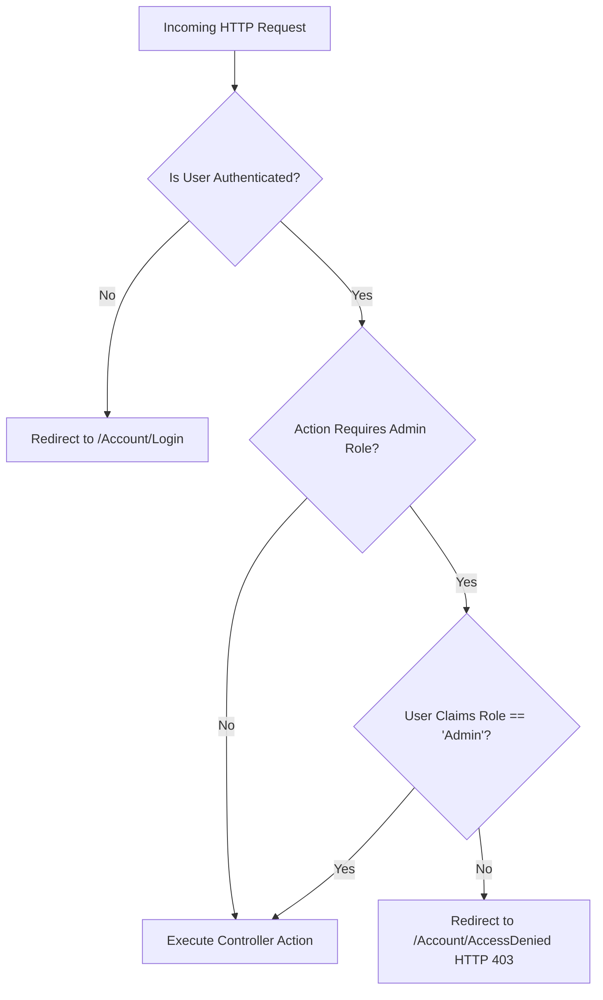

# 02. Roles and Permissions Matrix

## 1. Overview

PharmaDesk enforces a strict, two-tier role model:
- **`Admin`**: The pharmacy owner or head pharmacist. Possesses unrestricted administrative privileges across catalog, finances, staff, purchasing, backups, and audits.
- **`Staff`**: Cashiers and dispensing technicians. Possesses operational access to dispense medicines, lookup stock, and check expiration warnings, but is restricted from modifying master data, viewing money totals, or altering system configurations.

> [!IMPORTANT]
> The legacy draft concepts of **"Sections"** and **"Management"** were permanently abolished. All user permissions are determined strictly by the `Role` column on the `TeamMembers` entity (`Admin` or `Staff`).

---

## 2. Comprehensive Permission Matrix

| Screen / Feature | Admin | Staff | Operational Scope & Business Rules |
|---|:---:|:---:|---|
| **Dashboard** | ✅ Full | ⚠️ Counts Only | Admin views today's revenue totals ($), sales count, and low stock count. Staff sees transaction count and low stock counts only (no financial revenue cards). |
| **New Sale** | ✅ Yes | ✅ Yes | Barcode scanning, item lookup, cart manipulation, and checkout. |
| **Sales History** | ✅ All Sales | ⚠️ Own Sales Only | Admin inspects all pharmacy sales across all operators. Staff is filtered strictly to sales created by their own `TeamMemberId`. |
| **Medicines Catalog** | ✅ Full CUD | 👁️ View & Search | Admin can Add, Edit, Change Selling Price, and Toggle Active status. Staff can only search and view details. |
| **Stock & Batches** | ✅ Yes | 👁️ View Only | Both roles can view active stock by medicine and drill down into batch expiration details. Neither can directly mutate batches without a purchase/sale. |
| **Expiry Report** | ✅ Yes | ✅ Yes | Visual report identifying expired (red) and expiring within 90 days (orange) batches. |
| **Low Stock Report** | ✅ Yes | ✅ Yes | Medicines whose total unexpired stock is $\le$ `LowStockLevel`. |
| **Suppliers Management** | ✅ Yes | ❌ Blocked | Admin manages supplier contacts and addresses. Staff access is forbidden. |
| **Purchases (Inward Stock)** | ✅ Yes | ❌ Blocked | Recording supplier invoices, creating batches, and raising inventory. Staff cannot record purchases. |
| **Daily Sales Report** | ✅ Yes | ❌ Blocked | Financial summary reporting total revenue, total sales, and breakdown per team member. |
| **Team Members Management** | ✅ Yes | ❌ Blocked | Create staff, reset PINs, and deactivate accounts. Inaccessible to Staff. |
| **Database Backup** | ✅ Yes | ❌ Blocked | One-button manual database backup to disk or USB. Admin only. |
| **Activity Audit Log** | ✅ Yes | ❌ Blocked | Inspection of the immutable audit trail (who did what and when). Admin only. |

---

## 3. Enforcement Layers

Security in PharmaDesk is implemented using **Defense in Depth**:



### 1. Presentation Layer (Dynamic Menu)
In `PharmaDesk/Views/Shared/_Layout.cshtml`, the navigation sidebar renders links based on the user's role claims:
```razor
@if (User.IsInRole("Admin"))
{
    <a asp-controller="Supplier" asp-action="Index"><i class="bi bi-truck"></i> Suppliers</a>
    <a asp-controller="Purchase" asp-action="Index"><i class="bi bi-bag-check"></i> Purchases</a>
    <a asp-controller="Report" asp-action="Index"><i class="bi bi-graph-up"></i> Reports</a>
    <a asp-controller="TeamMember" asp-action="Index"><i class="bi bi-people"></i> Team Members</a>
    <a asp-controller="Backup" asp-action="Index"><i class="bi bi-hdd"></i> Backup</a>
    <a asp-controller="ActivityLog" asp-action="Index"><i class="bi bi-clock-history"></i> Activity Log</a>
}
```

### 2. Server-Side Controller Enforcement
Presentation filtering alone is insufficient. All administrative controllers and CUD actions must be decorated with `[Authorize(Roles = "Admin")]`:
```csharp
[Authorize(Roles = "Admin")]
public class TeamMemberController : Controller { ... }

[Authorize(Roles = "Admin")]
public class SupplierController : Controller { ... }

[Authorize(Roles = "Admin")]
public class PurchaseController : Controller { ... }
```
When a Staff user attempts to forge a request to `/Supplier/Create` or `/Purchase/Create`, ASP.NET Core authorization intercepts the request and issues an immediate redirect to `/Account/AccessDenied` (HTTP 403).

### 3. Data-Level Scoping
For endpoints shared by both roles (such as `SaleController.History`), query filtering must be enforced at the data layer:
```csharp
var query = _context.Sales.AsQueryable();
if (!User.IsInRole("Admin"))
{
    var currentUserId = int.Parse(User.FindFirstValue(ClaimTypes.NameIdentifier)!);
    query = query.Where(s => s.TeamMemberId == currentUserId);
}
```
