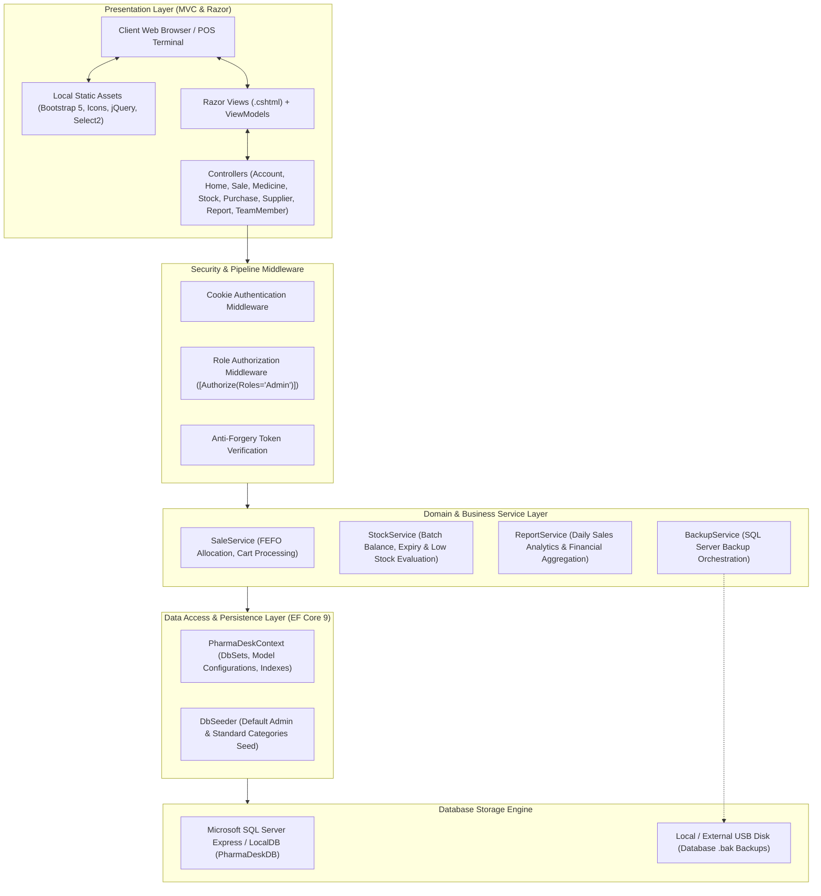
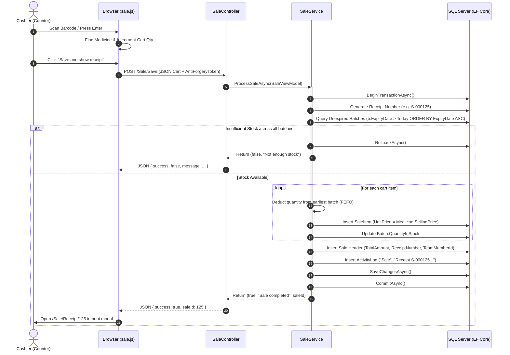
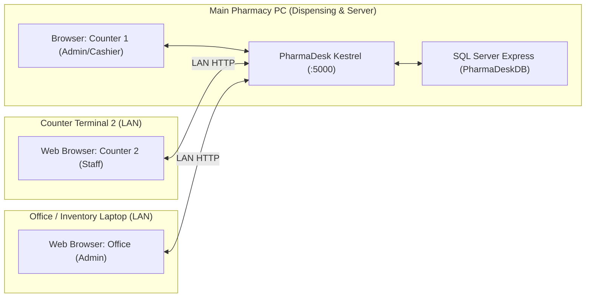

# 03. Architecture & System Design

## 1. Architectural Style & Principles

PharmaDesk is designed as a **monolithic, layered ASP.NET Core MVC application** running on **.NET 9**. The architecture follows three primary tenets:

1. **Offline-First & Local Autonomous Execution**: The application, database, and presentation assets operate entirely within the local machine perimeter. No external cloud calls or CDN requests are permitted.
2. **ACID Financial and Inventory Transactions**: Business logic involving inventory balance shifts, batch allocations, and receipt creation occurs within explicit database transactions (`IDbContextTransaction`).
3. **Layered Separation of Concerns**: Controllers delegate domain calculations (such as FEFO allocation, report aggregation, and backup commands) to a dedicated Service Layer, keeping controllers thin and focused on HTTP request lifecycle, validation, and view presentation.

---

## 2. Layered Component Diagram



---

## 3. Directory & Folder Layout

The repository is structured to maintain clean boundaries between models, viewmodels, data access, services, controllers, and static client assets:

```
PharmaDesk/
├── Controllers/                 # HTTP request handlers and endpoint routing
│   ├── AccountController.cs     # PIN authentication, cookie issuance, and lockout
│   ├── CategoryController.cs    # Medicine category administration
│   ├── HomeController.cs        # Main operational dashboard
│   ├── MedicineController.cs    # Product catalog management
│   ├── PurchaseController.cs    # Supplier invoice & inward batch reception
│   ├── ReportController.cs      # Expiry, low-stock, and sales reports
│   ├── SaleController.cs        # Counter POS cart and receipt printing
│   ├── StockController.cs       # Live stock and batch drill-down inspection
│   ├── SupplierController.cs    # Vendor directory management
│   └── TeamMemberController.cs  # Staff user administration and PIN resets
├── Data/                        # Persistence context and seed infrastructure
│   ├── DbSeeder.cs              # Initial administrator and category seeding
│   └── PharmaContext.cs         # EF Core DbContext, relationships, and index definitions
├── Models/                      # Core domain entities (one class per database table)
│   ├── ActivityLog.cs           # System audit trail entity
│   ├── Batch.cs                 # Physical batch inventory entity
│   ├── Category.cs              # Medicine category entity
│   ├── Medicine.cs              # Product catalog entity
│   ├── Purchase.cs              # Supplier purchase header entity
│   ├── PurchaseItem.cs          # Supplier purchase line item entity
│   ├── Sale.cs                  # Customer sales transaction header entity
│   ├── SaleItem.cs              # Customer sales transaction line item entity
│   ├── Supplier.cs              # Vendor entity
│   └── TeamMember.cs            # Cashier and administrator user entity
├── Services/                    # Domain logic & transactional workflows
│   ├── SaleService.cs           # Transactional FEFO checkout processing
│   ├── StockService.cs          # (Planned) Dedicated batch and stock calculations
│   ├── BackupService.cs         # (Planned) Database backup automation
│   └── ReportService.cs         # (Planned) Reporting aggregation service
├── ViewModels/                  # Strongly typed UI request/response models
│   ├── LoginViewModel.cs        # User selection and PIN input
│   ├── MedicineViewModel.cs     # Product creation and editing UI shape
│   ├── PurchaseViewModel.cs     # Multi-item purchase form shape
│   ├── SaleViewModel.cs         # POS cart and item payload
│   ├── StockViewModel.cs        # Consolidated stock display shape
│   └── TeamMemberViewModel.cs   # Staff account management shape
├── Views/                       # Razor view templates organized by controller
│   ├── Account/                 # Login and AccessDenied views
│   ├── Category/                # Category CRUD views
│   ├── Home/                    # Dashboard view
│   ├── Medicine/                # Catalog listing, creation, and edit views
│   ├── Purchase/                # Purchase invoice creation and index views
│   ├── Report/                  # Expiry, Low Stock, and Daily Sales report views
│   ├── Sale/                    # POS Counter, Sales History, and Receipt views
│   ├── Shared/                  # _Layout.cshtml, error pages, validation partials
│   ├── Stock/                   # Stock index and batch details drill-down
│   ├── Supplier/                # Vendor CRUD views
│   └── TeamMember/              # User management views
├── wwwroot/                     # Static web assets
│   ├── css/                     # Custom application styles
│   ├── js/                      # sale.js (POS cart logic), purchase.js
│   └── lib/                     # Local vendor packages (Bootstrap, Icons, jQuery, Select2)
├── appsettings.json             # Connection string and runtime logging configuration
├── GlobelUsing.cs               # Global namespace imports
└── Program.cs                   # Application bootstrapping, DI, pipeline configuration
```

---

## 4. End-to-End Request Flow

### 4.1 POS Sale Request Flow



---

## 5. Network Topology & Future Expansion

PharmaDesk is deployed initially as a **Single-PC Workstation**:
- ASP.NET Core Kestrel and SQL Server Express run on the same Windows host machine.
- The browser opens `http://localhost:5000`.

### Local Area Network (LAN) Readiness
Because the system is built with web technologies, scaling to multiple counter terminals within the same pharmacy requires **zero architectural refactoring**:



To enable multi-terminal LAN usage:
1. Configure Kestrel in `Program.cs` or `appsettings.json` to bind to `http://0.0.0.0:5000`.
2. Allow incoming port 5000 on the Windows Defender Firewall of the main PC.
3. Secondary counter computers open `http://<main-pc-ip>:5000` in their standard browser.
