# 04. Data Model & Data Dictionary

## 1. Corrected Entity-Relationship Diagram

The diagram below represents the **canonical data model** of PharmaDesk. It incorporates all fields from the **Technical Design Data Dictionary** (the Source of Truth), correcting all omissions from the earlier conceptual diagram (including `Unit`, `GenericName`, `Address`, `InvoiceNumber`, `PaymentMethod`, `ReceiptNumber`, `FailedPinCount`, `LockedUntil`, `CreatedAt`, `Batches.PurchaseItemId`, and the complete `ActivityLog` table).

```mermaid
erDiagram
    TeamMembers ||--o{ Sales : "makes"
    TeamMembers ||--o{ Purchases : "records"
    TeamMembers ||--o{ ActivityLogs : "performs"
    Categories ||--o{ Medicines : "classifies"
    Medicines ||--o{ Batches : "tracks"
    Medicines ||--o{ SaleItems : "sold_in"
    Medicines ||--o{ PurchaseItems : "ordered_in"
    Suppliers ||--o{ Purchases : "supplies"
    Purchases ||--|{ PurchaseItems : "contains"
    Sales ||--|{ SaleItems : "contains"
    Batches ||--o{ SaleItems : "allocated_to"
    PurchaseItems ||--o| Batches : "originates"

    TeamMembers {
        int Id PK "Auto increment"
        string FullName "100 chars, required"
        string PinHash "200 chars, hashed PBKDF2"
        string Role "10 chars: 'Admin' or 'Staff'"
        bool IsActive "Default true"
        int FailedPinCount "Default 0, max 5"
        datetime LockedUntil "Nullable, lock timestamp"
        datetime CreatedAt "UTC timestamp"
    }

    Categories {
        int Id PK "Auto increment"
        string Name "60 chars, unique, required"
    }

    Medicines {
        int Id PK "Auto increment"
        string Name "150 chars, required"
        string GenericName "150 chars, optional"
        string Barcode "50 chars, unique, required"
        int CategoryId FK "Points to Categories"
        string Unit "20 chars, e.g. Box, Strip"
        decimal SellingPrice "10,2 > 0, required"
        int LowStockLevel "Default 10, required"
        bool IsActive "Default true"
    }

    Batches {
        int Id PK "Auto increment"
        int MedicineId FK "Points to Medicines"
        string BatchNumber "50 chars, required"
        date ExpiryDate "DateOnly, future on receive"
        int QuantityInStock "Cannot drop below 0"
        decimal CostPrice "10,2 purchase price per unit"
        int PurchaseItemId FK "Nullable lineage to purchase line"
    }

    Suppliers {
        int Id PK "Auto increment"
        string Name "100 chars, required"
        string Phone "30 chars, optional"
        string Address "200 chars, optional"
        string Notes "300 chars, optional"
        bool IsActive "Default true"
    }

    Purchases {
        int Id PK "Auto increment"
        int SupplierId FK "Points to Suppliers"
        string InvoiceNumber "50 chars, optional"
        datetime PurchaseDate "Default now"
        decimal TotalCost "12,2 sum of items"
        int TeamMemberId FK "Who recorded the purchase"
    }

    PurchaseItems {
        int Id PK "Auto increment"
        int PurchaseId FK "Points to Purchases"
        int MedicineId FK "Points to Medicines"
        string BatchNumber "50 chars, required"
        date ExpiryDate "DateOnly, required"
        int Quantity "Greater than 0"
        decimal CostPrice "10,2 cost for one unit"
    }

    Sales {
        int Id PK "Auto increment"
        string ReceiptNumber "20 chars, unique, e.g. S-000125"
        datetime SaleDate "Default now"
        decimal TotalAmount "12,2 sum of items"
        string PaymentMethod "20 chars, 'Cash' in v1"
        int TeamMemberId FK "Who made the sale"
    }

    SaleItems {
        int Id PK "Auto increment"
        int SaleId FK "Points to Sales"
        int MedicineId FK "Points to Medicines"
        int BatchId FK "Specific batch allocated"
        int Quantity "Greater than 0"
        decimal UnitPrice "10,2 price snapshot at sale"
    }

    ActivityLogs {
        int Id PK "Auto increment"
        int TeamMemberId FK "Who performed action"
        string Action "50 chars: Login, Sale, Purchase, etc."
        string Details "300 chars metadata"
        datetime CreatedAt "UTC timestamp"
    }
```



---

## 2. Complete Data Dictionary

### 2.1 Table: `TeamMembers`
Stores user credentials, access tiers, and security lockout states for system operators.

| Column | C# Type | SQL Server Type | Nullable | Default | Constraints & Business Rules |
|---|---|---|:---:|---|---|
| `Id` | `int` | `INT IDENTITY(1,1)` | No | Auto | Primary Key. |
| `FullName` | `string` | `NVARCHAR(100)` | No | — | Displayed on sales receipts, reports, and activity logs. |
| `PinHash` | `string` | `NVARCHAR(200)` | No | — | Secure cryptographic hash (PBKDF2 via `PasswordHasher<TeamMember>`). Never plain text. |
| `Role` | `string` | `NVARCHAR(10)` | No | `'Staff'` | Permitted values: `'Admin'` or `'Staff'`. |
| `IsActive` | `bool` | `BIT` | No | `1` (true) | Soft delete flag. When `false`, user is blocked from logging in. |
| `FailedPinCount`| `int` | `INT` | No | `0` | Incremented on bad PIN; triggers lockout upon reaching 5. |
| `LockedUntil` | `DateTime?`| `DATETIME2` | Yes | `NULL` | Timestamp until which authentication is rejected (set to +5 mins on lockout). |
| `CreatedAt` | `DateTime` | `DATETIME2` | No | `DateTime.UtcNow` | Audit creation timestamp. |

---

### 2.2 Table: `Categories`
Classifies medicines into standard pharmaceutical forms (e.g., Tablets, Syrups, Injections).

| Column | C# Type | SQL Server Type | Nullable | Default | Constraints & Business Rules |
|---|---|---|:---:|---|---|
| `Id` | `int` | `INT IDENTITY(1,1)` | No | Auto | Primary Key. |
| `Name` | `string` | `NVARCHAR(60)` | No | — | Unique constraint (`IX_Categories_Name`). Case-insensitive uniqueness. |

---

### 2.3 Table: `Medicines`
The catalog master table representing individual pharmaceutical trade products.

| Column | C# Type | SQL Server Type | Nullable | Default | Constraints & Business Rules |
|---|---|---|:---:|---|---|
| `Id` | `int` | `INT IDENTITY(1,1)` | No | Auto | Primary Key. |
| `Name` | `string` | `NVARCHAR(150)` | No | — | Brand/trade name (e.g. Panadol Extra 500mg). Indexed for fast search. |
| `GenericName` | `string?` | `NVARCHAR(150)` | Yes | `NULL` | Active pharmaceutical ingredient (helps generic substitution search). |
| `Barcode` | `string` | `NVARCHAR(50)` | No | — | Unique index (`IX_Medicines_Barcode`). Scanned at checkout. |
| `CategoryId` | `int` | `INT` | No | — | Foreign key to `Categories(Id)`. |
| `Unit` | `string` | `NVARCHAR(20)` | No | — | Packaging unit: Box, Strip, Bottle, Tube, Ampoule. |
| `SellingPrice`| `decimal`| `DECIMAL(10,2)` | No | — | Retail counter price. Must be $> 0.00$. |
| `LowStockLevel`| `int` | `INT` | No | `10` | Alert threshold. Triggers low stock warning when `TotalStock` $\le$ threshold. |
| `IsActive` | `bool` | `BIT` | No | `1` (true) | Soft delete flag. Medicines with historical sales are set to `false`, never deleted. |

*Computed Property*: `TotalStock` is dynamically evaluated as the sum of unexpired batch quantities:
$$\text{TotalStock} = \sum_{\substack{b \in \text{Batches} \\ b.\text{ExpiryDate} > \text{Today}}} b.\text{QuantityInStock}$$

---

### 2.4 Table: `Batches`
Tracks physical inventory lots for each medicine, maintaining distinct shelf-life and purchase costs.

| Column | C# Type | SQL Server Type | Nullable | Default | Constraints & Business Rules |
|---|---|---|:---:|---|---|
| `Id` | `int` | `INT IDENTITY(1,1)` | No | Auto | Primary Key. |
| `MedicineId` | `int` | `INT` | No | — | Foreign key to `Medicines(Id)`. |
| `BatchNumber` | `string` | `NVARCHAR(50)` | No | — | Manufacturer lot number printed on carton/foil. |
| `ExpiryDate` | `DateOnly` | `DATE` | No | — | Expiration date. Indexed (`IX_Batches_ExpiryDate`). Must be future on receipt. |
| `QuantityInStock`| `int` | `INT` | No | `0` | Physical units remaining in this batch. Cannot drop below 0. |
| `CostPrice` | `decimal`| `DECIMAL(10,2)` | No | — | Supplier purchase price per single unit for this batch. |
| `PurchaseItemId`| `int?` | `INT` | Yes | `NULL` | Optional lineage link to `PurchaseItems(Id)` that introduced this batch. |

---

### 2.5 Table: `Suppliers`
Directory of pharmaceutical distributors and manufacturers.

| Column | C# Type | SQL Server Type | Nullable | Default | Constraints & Business Rules |
|---|---|---|:---:|---|---|
| `Id` | `int` | `INT IDENTITY(1,1)` | No | Auto | Primary Key. |
| `Name` | `string` | `NVARCHAR(100)` | No | — | Distributor or company name. |
| `Phone` | `string?` | `NVARCHAR(30)` | Yes | `NULL` | Contact telephone number. |
| `Address` | `string?` | `NVARCHAR(200)` | Yes | `NULL` | Warehouse or office physical address. |
| `Notes` | `string?` | `NVARCHAR(300)` | Yes | `NULL` | Payment terms, representative info, or delivery notes. |
| `IsActive` | `bool` | `BIT` | No | `1` (true) | Soft delete flag. Hidden when inactive; historical purchases preserved. |

---

### 2.6 Table: `Purchases`
Header document representing an inward stock delivery from a supplier.

| Column | C# Type | SQL Server Type | Nullable | Default | Constraints & Business Rules |
|---|---|---|:---:|---|---|
| `Id` | `int` | `INT IDENTITY(1,1)` | No | Auto | Primary Key. |
| `SupplierId` | `int` | `INT` | No | — | Foreign key to `Suppliers(Id)`. |
| `InvoiceNumber`| `string?`| `NVARCHAR(50)` | Yes | `NULL` | Supplier's external paper invoice or delivery slip number. |
| `PurchaseDate`| `DateTime` | `DATETIME2` | No | `DateTime.UtcNow`| Date and time invoice was received and entered. |
| `TotalCost` | `decimal`| `DECIMAL(12,2)` | No | — | Total invoice monetary sum ($\sum \text{Item}.\text{Quantity} \times \text{Item}.\text{CostPrice}$). |
| `TeamMemberId`| `int` | `INT` | No | — | Foreign key to `TeamMembers(Id)` identifying who received the stock. |

---

### 2.7 Table: `PurchaseItems`
Individual line item within an inward purchase invoice.

| Column | C# Type | SQL Server Type | Nullable | Default | Constraints & Business Rules |
|---|---|---|:---:|---|---|
| `Id` | `int` | `INT IDENTITY(1,1)` | No | Auto | Primary Key. |
| `PurchaseId` | `int` | `INT` | No | — | Foreign key to `Purchases(Id)` (`DeleteBehavior.Cascade`). |
| `MedicineId` | `int` | `INT` | No | — | Foreign key to `Medicines(Id)` (`DeleteBehavior.Restrict`). |
| `BatchNumber` | `string` | `NVARCHAR(50)` | No | — | Lot number copied directly into the corresponding new `Batch`. |
| `ExpiryDate` | `DateOnly` | `DATE` | No | — | Expiration date copied directly into the new `Batch`. Must be in future. |
| `Quantity` | `int` | `INT` | No | — | Units received. Must be $> 0$. |
| `CostPrice` | `decimal`| `DECIMAL(10,2)` | No | — | Agreed acquisition cost for ONE unit. Must be $> 0.00$. |

---

### 2.8 Table: `Sales`
Header document representing a completed retail counter checkout transaction.

| Column | C# Type | SQL Server Type | Nullable | Default | Constraints & Business Rules |
|---|---|---|:---:|---|---|
| `Id` | `int` | `INT IDENTITY(1,1)` | No | Auto | Primary Key. |
| `ReceiptNumber`| `string`| `NVARCHAR(20)` | No | — | Unique receipt code (`IX_Sales_ReceiptNumber`). Format: `S-000125`. |
| `SaleDate` | `DateTime` | `DATETIME2` | No | `DateTime.UtcNow`| Timestamp transaction was committed. Indexed (`IX_Sales_SaleDate`). |
| `TotalAmount` | `decimal`| `DECIMAL(12,2)` | No | — | Total monetary value charged to customer ($\sum \text{Item}.\text{LineTotal}$). |
| `PaymentMethod`| `string`| `NVARCHAR(20)` | No | `'Cash'` | Payment medium (`'Cash'` only in version 1.0). |
| `TeamMemberId`| `int` | `INT` | No | — | Foreign key to `TeamMembers(Id)` identifying the dispensing cashier. |

---

### 2.9 Table: `SaleItems`
Individual line item within a sale receipt, mapped to the exact batch dispensed under FEFO rules.

| Column | C# Type | SQL Server Type | Nullable | Default | Constraints & Business Rules |
|---|---|---|:---:|---|---|
| `Id` | `int` | `INT IDENTITY(1,1)` | No | Auto | Primary Key. |
| `SaleId` | `int` | `INT` | No | — | Foreign key to `Sales(Id)` (`DeleteBehavior.Cascade`). |
| `MedicineId` | `int` | `INT` | No | — | Foreign key to `Medicines(Id)` (`DeleteBehavior.Restrict`). |
| `BatchId` | `int` | `INT` | No | — | Foreign key to `Batches(Id)` (`DeleteBehavior.Restrict`). Identifies batch drawn. |
| `Quantity` | `int` | `INT` | No | — | Units taken from this specific batch. Must be $> 0$ and $\le \text{Batch}.\text{QuantityInStock}$. |
| `UnitPrice` | `decimal`| `DECIMAL(10,2)` | No | — | **Price snapshot** copied from `Medicine.SellingPrice` at sale moment. |

---

### 2.10 Table: `ActivityLog`
Append-only system audit trail tracking sensitive operational events and system security.

| Column | C# Type | SQL Server Type | Nullable | Default | Constraints & Business Rules |
|---|---|---|:---:|---|---|
| `Id` | `int` | `INT IDENTITY(1,1)` | No | Auto | Primary Key. |
| `TeamMemberId`| `int` | `INT` | No | — | Foreign key to `TeamMembers(Id)` (`DeleteBehavior.Restrict`). |
| `Action` | `string` | `NVARCHAR(50)` | No | — | Action verb: `'Login'`, `'Sale'`, `'Purchase'`, `'PriceChange'`, `'Backup'`. |
| `Details` | `string?` | `NVARCHAR(300)` | Yes | `NULL` | Context details (e.g. "Receipt S-000125, Total: $45.00"). |
| `CreatedAt` | `DateTime` | `DATETIME2` | No | `DateTime.UtcNow`| UTC timestamp when action occurred. |

---

## 3. Relationships & Foreign Key Delete Behaviors

In EF Core (`PharmaDeskContext.OnModelCreating`), delete behaviors are configured with surgical precision to ensure historical data can never be accidentally erased or corrupted:

```
                        ┌──────────────┐
                        │  Categories  │
                        └──────┬───────┘
                               │ Restrict (Cannot delete Category with Medicines)
                               ▼
┌──────────────┐        ┌──────────────┐        ┌──────────────┐
│  Suppliers   │        │  Medicines   │        │ TeamMembers  │
└──────┬───────┘        └───┬───┬───┬──┘        └───┬───┬───┬──┘
       │ Restrict           │   │   │               │   │   │
       ▼                    │   │   │               │   │   │
┌──────────────┐            │   │   │ Restrict      │   │   │ Restrict
│  Purchases   │◄───────────┘   │   │ (Historical)  │   │   │ (Audit & Lineage)
└──────┬───────┘                │   │               │   │   │
       │ Cascade                │   │               │   │   │
       ▼                        ▼   ▼               ▼   ▼   ▼
┌──────────────┐   SetNull    ┌──────────────┐    ┌──────────────┐
│PurchaseItems │─────────────►│   Batches    │    │ ActivityLog  │
└──────────────┘              └──────┬───────┘    └──────────────┘
                                     │ Restrict
                                     ▼
                              ┌──────────────┐
                              │  SaleItems   │
                              └──────▲───────┘
                                     │ Cascade
                              ┌──────┴───────┐
                              │    Sales     │
                              └──────────────┘
```

| Relationship (One → Many) | Foreign Key | EF Core `DeleteBehavior` | Rationale & Protection Rule |
|---|---|:---:|---|
| `Categories` → `Medicines` | `Medicines.CategoryId` | `Restrict` | A category cannot be deleted while medicines belong to it. |
| `Medicines` → `Batches` | `Batches.MedicineId` | `Restrict` | A medicine cannot be deleted while stock batches exist. Must use soft delete (`IsActive = false`). |
| `Medicines` → `SaleItems` | `SaleItems.MedicineId` | `Restrict` | Protects closed sales receipts from losing referenced medicine names. |
| `Medicines` → `PurchaseItems`| `PurchaseItems.MedicineId`| `Restrict` | Protects inward supplier invoices from losing referenced medicine names. |
| `Batches` → `SaleItems` | `SaleItems.BatchId` | `Restrict` | A batch cannot be deleted if historical sales drew units from it. |
| `Suppliers` → `Purchases` | `Purchases.SupplierId` | `Restrict` | A vendor cannot be deleted if purchase invoices exist. Must use soft delete (`IsActive = false`). |
| `Purchases` → `PurchaseItems`| `PurchaseItems.PurchaseId`| `Cascade` | Deleting a purchase header cleans up its item lines. |
| `Sales` → `SaleItems` | `SaleItems.SaleId` | `Cascade` | Deleting a sale header cleans up its item lines (Admin only). |
| `PurchaseItems` → `Batches` | `Batches.PurchaseItemId` | `SetNull` | If a purchase line is removed, the physical batch remains in inventory with null lineage. |
| `TeamMembers` → `Sales` | `Sales.TeamMemberId` | `Restrict` | A staff account cannot be deleted if they processed sales. Must use soft delete (`IsActive = false`). |
| `TeamMembers` → `Purchases` | `Purchases.TeamMemberId` | `Restrict` | Cannot delete staff who received inventory. |
| `TeamMembers` → `ActivityLog`| `ActivityLog.TeamMemberId`| `Restrict` | Cannot delete staff whose actions are recorded in the audit log. |

---

## 4. Database Indexes for Performance

The following indexes are explicitly created in EF Core to ensure high-speed counter lookup and real-time report calculation:

| Entity | Index Target | Type | Primary Purpose |
|---|---|:---:|---|
| `Medicines` | `Barcode` | **Unique** | Instant barcode scanner lookup ($O(1)$) and duplicate prevention. |
| `Medicines` | `Name` | Non-Unique | Fast auto-complete and search modal filtering by medicine brand name. |
| `Batches` | `ExpiryDate` | Non-Unique | Accelerates FEFO order sorting and daily expiration report filtering. |
| `Sales` | `ReceiptNumber` | **Unique** | Instant receipt lookup and strict receipt numbering uniqueness. |
| `Sales` | `SaleDate` | Non-Unique | Fast date-range filtering for the Daily Sales Report and Dashboard. |
| `Categories`| `Name` | **Unique** | Prevents duplicate category definitions. |
