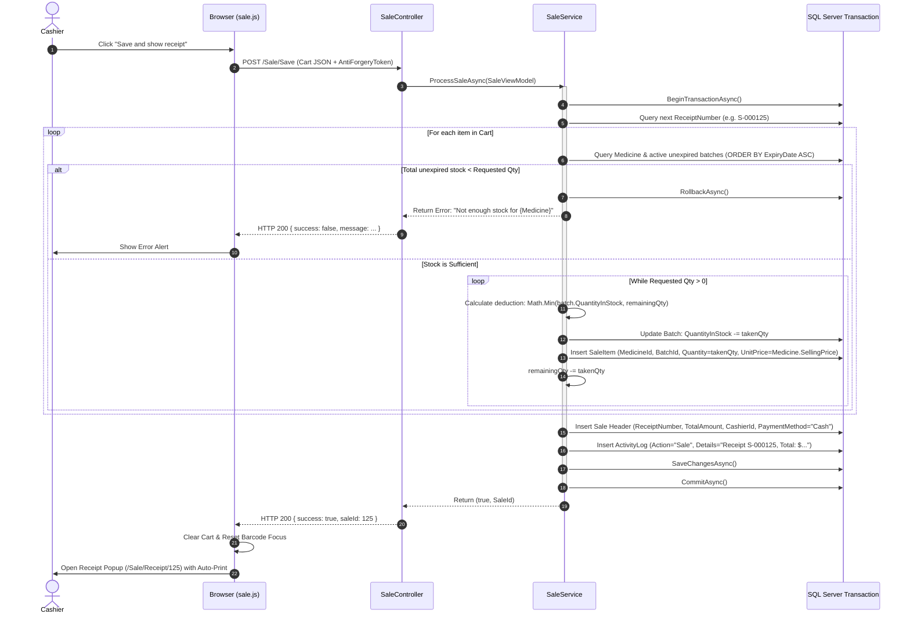
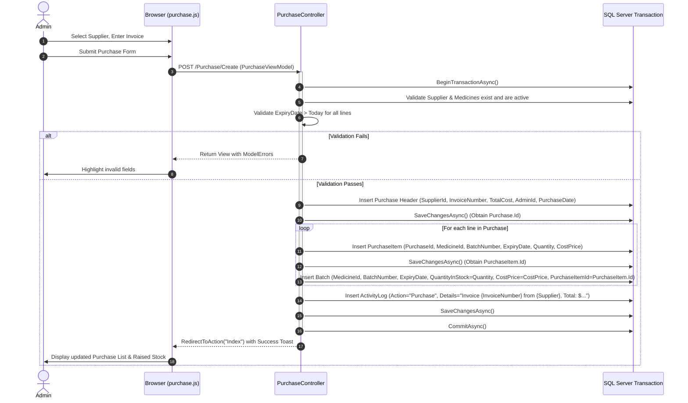

# 05. Core Business Rules & Transaction Workflows

## 1. Inventory & Dispensing Invariants

PharmaDesk enforces four foundational inventory rules at the domain logic level. These rules cannot be bypassed by UI shortcuts or direct API requests:

```
┌─────────────────────────────────────────────────────────────────────────────┐
│                       THE 4 CORE INVENTORY INVARIANTS                       │
├─────────────────────────────────────────────────────────────────────────────┤
│ 1. NO OVERSELLING                                                           │
│    Requested Sale Qty ≤ Total Available Unexpired Stock in Batches.         │
│                                                                             │
│ 2. NO EXPIRED STOCK DISPENSED                                               │
│    Batches with ExpiryDate ≤ Today are strictly excluded from sales.        │
│                                                                             │
│ 3. FEFO DEDUCTION (First-Expired, First-Out)                                │
│    Stock is deducted strictly by earliest ExpiryDate ASC. If a sale line     │
│    exceeds one batch, it is split across consecutive batches.               │
│                                                                             │
│ 4. ONE ATOMIC DATABASE TRANSACTION                                          │
│    Multi-table updates commit together or rollback completely.              │
└─────────────────────────────────────────────────────────────────────────────┘
```

---

## 2. Stock Calculation Formula

Inventory is **never** stored as a simple scalar column on the `Medicines` table. Storing a scalar balance invites synchronization drift. Instead, total sellable stock is calculated dynamically from active batches:

$$\text{TotalStock}(m) = \sum_{\substack{b \in \text{Batches} \\ b.\text{MedicineId} = m.\text{Id} \\ b.\text{ExpiryDate} > \text{Today} \\ b.\text{QuantityInStock} > 0}} b.\text{QuantityInStock}$$

- **Expired Batches ($\text{ExpiryDate} \le \text{Today}$)**: Excluded immediately from $\text{TotalStock}$. They cannot be added to a cart or sold.
- **Physical Segregation**: Expired inventory remains visible in the **Stock Drill-down** and **Expiry Report** screens (highlighted in red) until the administrator physically disposes or returns them to the supplier.

---

## 3. Visual Alert Rules (Expiry & Low Stock)

### 3.1 Expiry Date Color Coding
To ensure cashiers and pharmacists identify at-risk medications instantly, shelf-life is evaluated using standard color boundaries:

| State | Condition | Visual Indicator | Meaning / Action |
|---|---|:---:|---|
| **Expired** | $\text{ExpiryDate} \le \text{Today}$ | 🔴 **Red** (`#dc3545`) | **Critical**: Unsellable. Must be removed from counter shelves immediately. |
| **Close to Expiry** | $\text{Today} < \text{ExpiryDate} \le \text{Today} + 90\text{ days}$ | 🟠 **Orange** (`#fd7e14`) | **Warning**: Prioritize dispensing under FEFO; alert purchasing not to reorder. |
| **Healthy Shelf-Life** | $\text{ExpiryDate} > \text{Today} + 90\text{ days}$ | 🟢 **Green** (`#2e7d32`) | **Normal**: Standard sellable inventory. |

### 3.2 Low Stock Alert Rule
Each medicine specifies a configurable alert threshold (`LowStockLevel`, default: 10 units):

$$\text{IsLowStock}(m) \iff \text{TotalStock}(m) \le m.\text{LowStockLevel}$$

- Displayed prominently on the **Dashboard** in the "Low Stock Medicines" metric card.
- Filtered in the **Low Stock Report** (`/Report/LowStock`), ordered ascending by remaining stock so the most depleted medicines appear at the top.

---

## 4. Sequential Receipt Numbering

Sales receipts require unique, sequential, human-readable identifier strings:
- **Canonical Format**: `S-######` (e.g., `S-000001`, `S-000125`, `S-010450`).
- **Generation Rule**: The suffix is derived sequentially from the database identity seed or max transaction ID formatted with 6 digits (`nextNumber.ToString("D6")`).
- **Uniqueness**: Enforced by a unique database index on `Sales.ReceiptNumber` (`IX_Sales_ReceiptNumber`).
- **Audit Lineage**: The receipt number is mirrored directly into `ActivityLog.Details` for rapid cross-referencing.

---

## 5. Transaction Workflow: Save Sale (POS Checkout)

When a cashier clicks **"Save and show receipt"** on the POS counter screen, the following transactional process executes:



### Critical Implementation Details
- **Multi-Batch Splitting**: If a customer requests 5 boxes of Panadol, and Batch A has 2 boxes (expires in 15 days) while Batch B has 10 boxes (expires in 200 days), the system automatically allocates:
  - 2 boxes from Batch A $\rightarrow$ 1 `SaleItem` row pointing to Batch A.
  - 3 boxes from Batch B $\rightarrow$ 1 `SaleItem` row pointing to Batch B.
- **Price Snapshot**: The `UnitPrice` written into both `SaleItem` rows is strictly copied from `Medicine.SellingPrice` at that second.

---

## 6. Transaction Workflow: Save Purchase (Inward Stock Delivery)

When an administrator receives a pharmaceutical delivery from a vendor and saves the invoice:



### Critical Invariants for Purchases
1. **Expiry Date Validation**: Incoming batches must have $\text{ExpiryDate} > \text{Today}$. The pharmacy cannot accept already expired medicine shipments.
2. **Cost Price Semantics**: `CostPrice` on `PurchaseItems` and `Batches` represents the price for **ONE individual unit**, not the line total.
3. **Immediate Stock Raise**: Unlike retail systems with decoupled receiving docks, saving a purchase in PharmaDesk immediately creates active inventory in `Batches`, making stock instantly available for sale.
