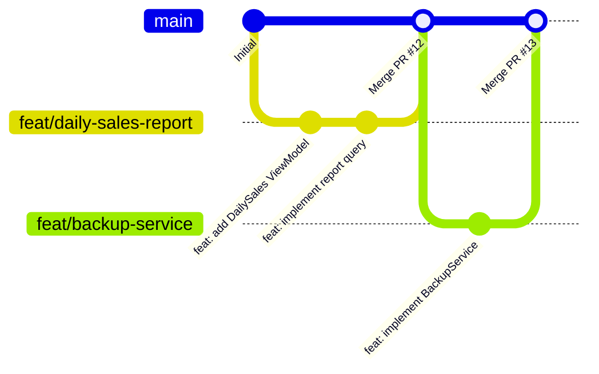

# 08. Development Workflow & Team Collaboration Guide

## 1. Branching Strategy

To prevent merge conflicts and maintain a pristine, deployable `main` branch, all development follows standard branch isolation rules:



### 1.1 Branch Naming Standard
Every branch must follow the format `<category>/<short-kebab-description>`:
- `feat/feature-name`: Adding new user-facing functionality (e.g. `feat/daily-sales-report`).
- `fix/bug-description`: Resolving a defect or regression (e.g. `fix/hardcoded-cashier-id`).
- `docs/documentation-topic`: Adding or updating documentation (e.g. `docs/project-documentation`).
- `refactor/scope-description`: Code improvements that do not change business behavior (e.g. `refactor/extract-stock-service`).
- `test/test-suite`: Adding unit, integration, or regression tests (e.g. `test/fefo-allocation-tests`).
- `chore/tooling-task`: Updating dependencies, project files, or CI scripts (e.g. `chore/remove-dead-model-files`).

### 1.2 Core Rules
1. **Never commit directly to `main`**: All changes enter `main` exclusively through Pull Requests.
2. **Short-Lived Feature Branches**: Branches should ideally be merged within 1 to 2 days to minimize drift.
3. **Rebase or Merge Main Frequently**: Before opening a PR, rebase or merge `main` into your feature branch to resolve any conflicts locally.

---

## 2. Commit Message Convention (Conventional Commits)

Commit messages must follow the [Conventional Commits v1.0.0](https://www.conventionalcommits.org/) specification:

```
<type>(<optional-scope>): <short imperative summary>

[optional detailed body explaining context and rationale]

[optional footer(s), e.g. Closes #14]
```

### 2.1 Permitted Types
- **`feat`**: A new feature (e.g., `feat(sales): add daily sales summary report`).
- **`fix`**: A bug fix (e.g., `fix(auth): resolve hardcoded cashier id in sale checkout`).
- **`docs`**: Documentation changes only (e.g., `docs(architecture): add sequence diagram for FEFO`).
- **`refactor`**: Code restructuring without functional behavior changes (e.g., `refactor(inventory): extract batch deduction to StockService`).
- **`test`**: Adding or correcting tests (e.g., `test(fefo): add unit test for multi-batch splitting`).
- **`chore`**: Build system, package updates, or repository maintenance (e.g., `chore(db): create initial EF Core migration`).

### 2.2 Examples
```text
feat(reports): add Daily Sales report controller and view

Implements the Daily Sales report screen displaying gross revenue,
transaction counts, and per-cashier breakdowns for administrators.

Closes #18
```

```text
fix(security): apply Authorize attribute to Category and Supplier controllers

Enforces [Authorize(Roles = "Admin")] across CategoryController,
SupplierController, and PurchaseController to prevent unauthorized access by Staff.

Fixes #15
```

---

## 3. Pull Request Guidelines

1. **One Goal Per PR**: Keep pull requests focused on a single feature, bug fix, or refactor. Avoid combining unrelated changes.
2. **PR Description Requirements**:
   - Concise summary of changes.
   - Reference to the linked GitHub Issue (e.g., `Closes #12`).
   - Testing steps performed and verification evidence.
   - Confirmation that no secrets or unintended files were committed.
3. **Review & Approval Gate**:
   - At least one approving review is required before merging.
   - The reviewing engineer checks for: adherence to business rules (FEFO, transaction safety), correct role authorization, and code cleanliness.
4. **Squash and Merge**: Use "Squash and Merge" with a clean conventional commit title to keep git history readable on `main`.

---

## 4. Definition of Done (DoD)

A task or pull request is considered **Done** only when:
- [ ] **Clean Build**: `dotnet build` completes with 0 errors and 0 new warnings.
- [ ] **Architectural Integrity**: Business invariants (ADR 0004: FEFO, no oversell, atomic transactions) are strictly upheld.
- [ ] **Role Authorization**: All sensitive actions enforce `[Authorize(Roles = "Admin")]` on the server.
- [ ] **Audit Trail**: Any state-mutating operation (sale, purchase, price update) records an entry in `ActivityLog`.
- [ ] **No Secrets**: No database passwords or sensitive connection strings exist in committed files.
- [ ] **Documentation**: If the change introduces new configuration, endpoints, or rules, the relevant documents in `docs/` are updated.
- [ ] **Tested Locally**: The feature was tested in a local browser running offline with no internet connection.

---

## 5. Work Division Between Two Developers (Dev A & Dev B)

To enable seamless parallel development with **zero merge conflicts**, the remaining work is divided strictly across distinct files, controllers, views, and services. Each developer owns their specific vertical slice:

```
┌──────────────────────────────────────┐    ┌──────────────────────────────────────┐
│           DEVELOPER A                │    │           DEVELOPER B                │
├──────────────────────────────────────┤    ├──────────────────────────────────────┤
│ • Security Hardening & Auth Gates    │    │ • StockService & Inventory Logic     │
│ • User Context (CurrentUser Claims)  │    │ • Purchase Workflow Refactoring      │
│ • Daily Sales Report (Controller/UI) │    │ • BackupService & BackupController   │
│ • Sales History Scoping (Admin/Staff)│    │ • ActivityLogController & UI         │
│ • Database Migrations & Seeding      │    │ • Price Change Audit Interception    │
│ • File Cleanup (Dead/Misnamed files) │    │ • Self-Contained Offline Packaging   │
└──────────────────────────────────────┘    └──────────────────────────────────────┘
```

### 5.1 Step-by-Step Parallel Assignment Matrix

| Step | Work Item | Primary Owner | Files Modified / Created (Zero Overlap) |
|---|---|:---:|---|
| **Phase A** | **Initial EF Core Migration** | **Dev A** | `Migrations/*`, `Data/PharmaDeskContext.cs` |
| **Phase A** | **Clean Duplicate / Misnamed Files** | **Dev A** | Remove dead models, rename `CategoryController .cs` |
| **Phase B** | **Server-Side Authorization Gates** | **Dev A** | `CategoryController`, `SupplierController`, `MedicineController` |
| **Phase B** | **StockService Extraction** | **Dev B** | `Services/StockService.cs` (pure new service) |
| **Phase C** | **User Context in Sales & Purchases** | **Dev A** | `SaleService.cs`, `PurchaseController.cs` (resolve `User.Claims`) |
| **Phase C** | **Purchase Workflow Refactoring** | **Dev B** | `Services/PurchaseService.cs`, integrate with `StockService` |
| **Phase D** | **Daily Sales Report Implementation** | **Dev A** | `ReportController.cs` (`DailySales` action), `Views/Report/DailySales.cshtml` |
| **Phase D** | **Backup Service & Controller** | **Dev B** | `Services/BackupService.cs`, `Controllers/BackupController.cs`, `Views/Backup/Index.cshtml` |
| **Phase E** | **Sales History Multi-User Scoping** | **Dev A** | `SaleController.cs` (`History` filter), `Views/Sale/History.cshtml` |
| **Phase E** | **Activity Log Controller & Viewer** | **Dev B** | `Controllers/ActivityLogController.cs`, `Views/ActivityLog/Index.cshtml` |
| **Phase F** | **Price Change Audit Interception** | **Dev B** | `MedicineController.cs` (log price updates to `ActivityLog`) |
| **Phase F** | **Self-Contained Publish & Setup** | **Dev A** | Publish profiles, local setup scripts |

By strictly decoupling ownership—Dev A focusing on reporting, authentication context, and security gates; Dev B focusing on inventory services, backups, and audit trails—both developers can code simultaneously without conflicting pull requests.
